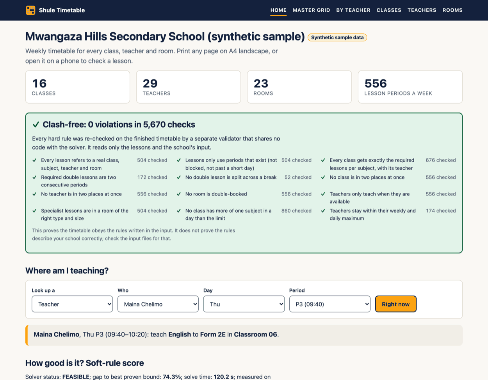
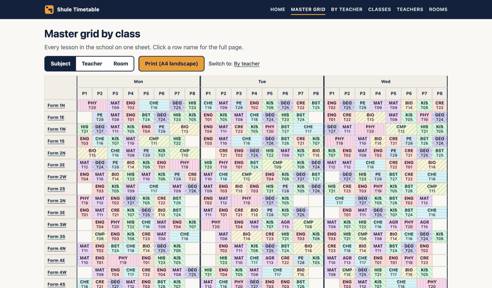
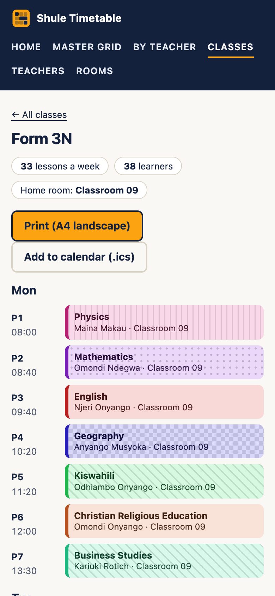
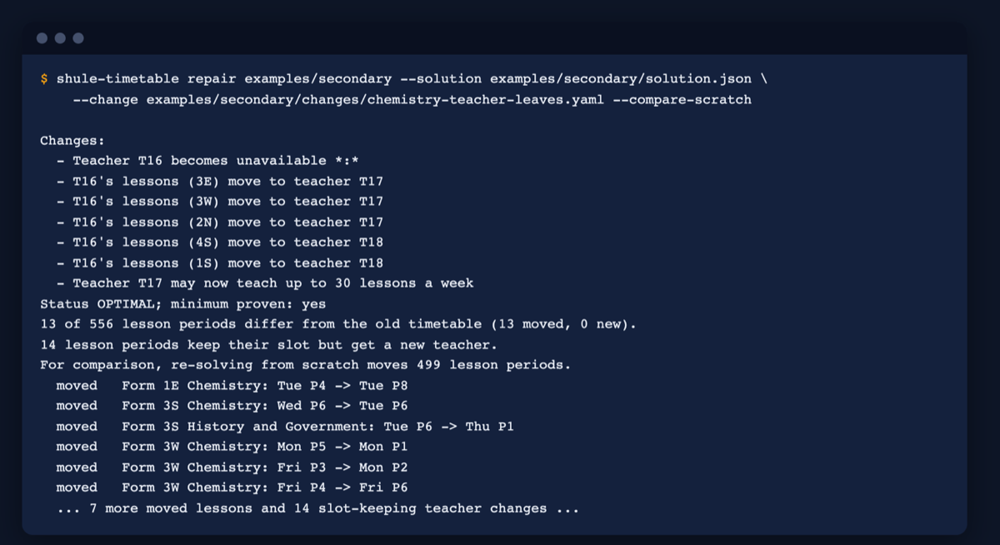
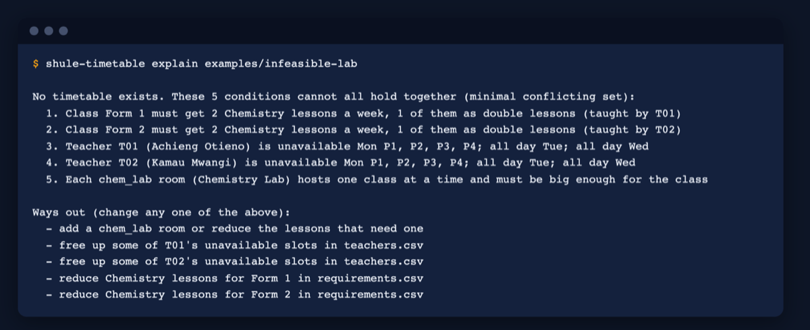
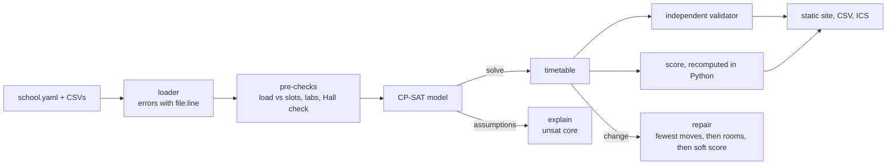

# Shule Timetable

**A constraint solver that builds a clash-free school timetable from plain CSV and YAML, then publishes printable pages for every class, teacher and room.**

[](https://github.com/Victor-Wambua/shule-timetable/actions/workflows/ci.yml)
[](LICENSE)


**Live sample (synthetic schools): <https://victor-wambua.github.io/shule-timetable/>**



> Status: portfolio build. Runs locally with synthetic sample data. Not field-tested with a real school.

## The problem

In many schools a deputy head spends days each term building the timetable by hand, on paper or
in Excel. One teacher ends up in two places, the chemistry lab is double-booked, someone has
eight lessons back to back, Friday afternoon is overloaded. Then a teacher leaves mid-term and
the whole thing is redone. The first draft is not the real cost; every change afterwards is.

## What it does

- **Reads plain files.** One `school.yaml` plus five CSVs (subjects, rooms, classes, teachers,
  lessons per class). [Format guide](docs/INPUT-FORMAT.md).
- **Says what is wrong before solving.** Every input mistake is reported with file and line, and
  pre-checks explain impossibility in numbers: *"Teacher T01 is assigned 8 lessons/week but is
  available in only 3 slots"*, *"Class Form 3N needs 44 lessons/week but only 38 slots exist"*.
- **Hard rules, never broken:** no class, teacher or room in two places; teacher availability and
  weekly/daily maximums; the right room type and size; exact lesson counts; double lessons
  (consecutive, never across a break); a daily limit per subject; lessons only in real periods.
- **Soft rules, weighted and configurable:** spread subjects across the week, no long back-to-back
  runs for teachers, few teacher or class gaps, heavy subjects in the morning, balanced days,
  first/last-period avoidance, keep chosen slots light, free days for teachers. The score
  breakdown is shown on the home page.
- **`explain`:** if no timetable exists, a minimal set of conflicting rules in plain English
  (from a CP-SAT unsat core), with ways out. If one exists, the resources close to full.
- **`repair`:** after a change (teacher unavailable, teacher leaves, extra lesson), re-solve while
  moving the fewest lessons. On the sample school, when a chemistry teacher leaves, **13 of 556
  lesson periods move** (proven minimum) against about 500 when re-solving from scratch.
- **Static site:** a page per class, teacher and room, master grids, CSV, and per-teacher and
  per-class calendar files (`.ics`). Colour plus a pattern for every subject, A4-landscape print
  layout, dark mode, a day-list view on phones, and a "Where am I teaching?" lookup.
- **An independent validator** re-checks all 12 hard rules on the output, with no code shared
  with the solver, and its result is the tick on every page.

| | |
|---|---|
|  |  |
| Master grid, every class on one sheet | A class on a phone: a plain list per day |





## Quick start

Needs [uv](https://docs.astral.sh/uv/). Python 3.12 is fetched by uv if you do not have it.

```bash
git clone https://github.com/Victor-Wambua/shule-timetable.git
cd shule-timetable
uv sync

# generate the synthetic primary school, solve it, run the validator, write the site
uv run shule-timetable demo --school primary --out out/primary --time-limit 20
open out/primary/site/index.html        # xdg-open on Linux
```

The bigger sample (16 classes, 29 teachers, labs) is `--school secondary`; the default time limit is
60 seconds.

Your own school:

```bash
uv run shule-timetable validate my-school/                    # input errors + impossibility pre-checks
uv run shule-timetable solve my-school/ -o my-school/solution.json --time-limit 120
uv run shule-timetable explain my-school/                     # why not / what is tight
uv run shule-timetable report my-school/ --solution my-school/solution.json --out site/
uv run shule-timetable repair my-school/ --solution my-school/solution.json \
    --change my-school/changes/teacher-leaves.yaml -o my-school/solution-v2.json --compare-scratch
```

Try the explainer on the committed impossible example:
`uv run shule-timetable explain examples/infeasible-lab`.

## How it works



Every class-subject has "a single starts here" and "a double starts here" variables per slot; a
double is only offered where the next period is in the same break-free segment. Rooms are a third
layer of variables for lessons that need a specialist room. The soft-rule objective is encoded
exactly, so the solver's number equals the plain-Python score, which a test asserts. The
reasoning, what a greedy approach fails at, and honest solve-time numbers are in the
[case study](docs/CASE-STUDY.md).

### Measured on this machine

Apple M4, 10 cores, OR-Tools 9.15. Synthetic data. One run each.

| School | Classes | Lessons/week | Result |
|---|---:|---:|---|
| Primary sample | 6 | 174 | feasible in <1 s; 30 s limit: penalty 96, proven bound 38 (60% gap) |
| Secondary sample | 16 | 556 | feasible in 0.7 s; 120 s limit: penalty 522, proven bound 134 (74% gap) |

Finding a valid timetable is fast; proving a *best* one is not, and no run here reached
optimality. Each home page states its own measured status and gap. Details and a size sweep up to 24
classes: [case study](docs/CASE-STUDY.md).

## Testing

```bash
uv run pytest            # 144 tests, about 17 s
uv run ruff check . && uv run ruff format --check .
uv run mypy
```

All 144 pass locally and in CI (ruff and mypy strict as well). They cover:

- **Validator:** 23 tests, a hand-built violating timetable for each of the 12 hard rules.
- **Pre-checks and input parsing:** 29 tests, including exact explanation text and file:line pointers.
- **Solver:** feasible, infeasible, deterministic with a fixed seed and one worker, and optima worked
  out by hand for each soft rule (for example a teacher free only at P1 and P4 costs exactly two gaps).
- **Property test:** for random small schools, anything the solver returns passes the validator, and
  at optimality its objective equals the independent score.
- **Explain and repair:** the unsat core is the expected rule set and every member is needed;
  repair moves the proven minimum and beats starting again.
- **Site, CSV, ICS, CLI end to end, sample generators.** No test touches the network.

## Project layout

```
src/shule_timetable/
  model.py  loader.py  prechecks.py     data model, input parsing, infeasibility pre-checks
  solver.py  scoring.py                 CP-SAT model; the same score in plain Python
  explain.py  repair.py                 unsat-core explanations; minimal-change re-solve
  validator.py                          independent hard-rule checker (no solver imports)
  report/                               static site, CSV and ICS writers
  demo.py  cli.py  storage.py           sample schools, command line, solution JSON
examples/  secondary/ primary/ infeasible-lab/   inputs, solutions, repair scenarios
benchmarks/  greedy.py scaling.py       the greedy baseline and the size sweep
docs/  CASE-STUDY.md INPUT-FORMAT.md screenshots/
tests/
```

## Configuration

Everything is in `school.yaml` (periods, breaks, short days, blocked slots, limits, soft-rule
weights); see the [format guide](docs/INPUT-FORMAT.md). Solver options on the command line:

| Option | Default | Meaning |
|---|---|---|
| `--time-limit` | 60 | seconds the solver may spend |
| `--seed` | 1 | random seed |
| `--workers` | 0 | 0 = all cores; 1 gives a repeatable run |

## Status and roadmap

Working: everything above. Known limitations:

- Not tried on a real school's requirements; the sample lesson counts are plausible, not official.
- Teachers are assigned to classes by you; the solver does not pick among qualified teachers.
- Optimality is rarely proven on school-sized instances; the page shows the real gap.
- One teacher per lesson, one room per lesson, one week pattern (no A/B weeks, no split classes).
- The calendar files and print layout are tested in code, not on a printer or in a calendar app.

Next: let the solver choose teachers (so repair can suggest who takes over), per-teacher
preferences, stronger lower bounds, a small web editor for the input.

## Author

Built by Victor Wambua — [portfolio](https://victor-wambua.github.io/victor-portfolio/) · [case studies](https://github.com/Victor-Wambua/case-studies)

MIT licensed, see [LICENSE](LICENSE).
